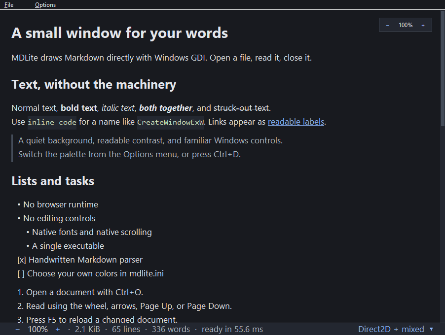

# MDLite

A read-only Markdown viewer for Windows. Written in Rust against the Win32 API
directly: no crates, no browser engine, no GUI framework, no bundled fonts. One
executable of about 430 KiB that opens a file, draws it, and stays out of the
way.



- **Three text pipelines, chosen per block.** GDI for Latin, GDI+ for Greek,
  Cyrillic and CJK, Direct2D for Arabic, Hebrew, Indic and Thai. Colour emoji
  are drawn glyph by glyph inside whichever pipeline drew the sentence. The
  footer names the one in use and explains why.
- **Markdown**: headings, emphasis, code, fenced blocks, lists, task marks,
  quotes, rules, links, image labels, and pipe tables with per-column alignment.
- **Colours you own.** Named palettes live in an INI and are edited in a
  settings window. The whole window follows the one you pick: title bar, menus,
  scrollbar, footer.
- **Scrolling that stays sharp.** Every frame is composed off-screen and shown in
  one blit, paced to the display's refresh, with the speed capped so the text can
  be followed. The wheel, arrows and Page keys ease in; dragging the scrollbar
  never does. Text zoom from 50% to 400%, per-monitor DPI, and a scrollbar drawn in
  your own colours.
- **Settings that fit.** Appearance, reading comfort, rendering and Markdown files
  in four boxes, every control sized from its own text so nothing overlaps or
  clips at any display scale.
- **A real installer.** An Inno Setup wizard that installs for you alone with no
  administrator rights, can make MDLite the default reader for `.md`, and an
  uninstaller that leaves nothing behind.

## Install

Run `MDLite-Setup-<version>.exe` (see [Build](#build) to make it). Requires 64-bit
Windows 10 version 1703 or later.

- **For you only** is the default: no administrator rights, installed under
  `%LOCALAPPDATA%\Programs\MDLite`. The first page also offers all users, which asks
  Windows for permission and installs under Program Files.
- **Make MDLite the default reader for Markdown files** is a box on the Tasks page.
  Windows lets a program decide for itself only when nothing opens that file type
  yet. Otherwise the last page of the wizard opens Windows **Default apps** with
  MDLite already listed, and the choice is yours. It need not be settled at install
  time: **Options > Settings > Set as default .md reader** does the same later.
- **Uninstall** from Windows Settings > Apps, or the Start menu. It closes MDLite if
  it is open, removes every file and registry entry the installer or the Settings
  button added, and asks whether to delete your settings too.

Your palettes and preferences are in `%APPDATA%\MDLite\mdlite.ini`, created on the
first run from the palettes the installer ships. They are kept across upgrades, and
across uninstalls unless you say otherwise. For a silent install or uninstall:

```powershell
# "assoc" is the default-reader task; leave /TASKS out to skip it.
MDLite-Setup-0.2.0.exe /VERYSILENT /CURRENTUSER /TASKS="assoc"
# /purge=1 also deletes your settings; without it a silent uninstall keeps them.
& "$env:LOCALAPPDATA\Programs\MDLite\unins000.exe" /VERYSILENT /purge=1
```

## Run without installing

`mdlite.exe` is one file with no runtime to install, so nothing has to be installed:

```powershell
.\dist\mdlite.exe .\examples\showcase.md
```

Or open it and drop a document on the window. A `mdlite.ini` beside the executable
makes it portable: it is used instead of the one in `%APPDATA%`.

| | |
| --- | --- |
| Open, reload | Ctrl+O, F5 |
| Scroll | Wheel, arrows, Page Up/Down, Space, Home/End |
| Text size | Ctrl+wheel, Ctrl+plus / Ctrl+minus / Ctrl+0 |
| Next palette | Ctrl+D |
| Settings, reread the INI | Ctrl+, and Ctrl+F5 |

## Make MDLite your default reader

The installer's task does it for you. Without the installer, keep `mdlite.exe` in a
permanent folder, open **Options > Settings** (`Ctrl+,`) and click **Set as default
.md reader**. It registers the current executable for your Windows account, makes it
the default for any Markdown extension that nothing opens yet, and opens Windows
Default apps so you can choose MDLite for the ones that something does. An existing
default changes only when you confirm it in Windows. Registration is immediate and
is not undone by Cancel; if you move the executable, click the button again.

## Build

Install stable Rust with a Windows toolchain, then:

```powershell
.\build.ps1 -Test
```

That runs the tests, builds offline, draws the icon, and puts `mdlite.exe` in
`dist`. There is nothing to download: the project has no dependencies.

To make the installer too, install [Inno Setup](https://jrsoftware.org/isinfo.php)
6.4 or later (`winget install JRSoftware.InnoSetup`) and run:

```powershell
.\installer\build-installer.ps1    # dist\installer\MDLite-Setup-<version>.exe
.\installer\verify-installer.ps1   # installs, checks, uninstalls, diffs the registry
```

## Documentation

- [How it works](docs/design.md) — the three pipelines, the palette and INI
  format, the Markdown subset, and the limits that keep a hostile file from
  taking the process down.
- [What was measured](docs/validation.md) — timings, memory, and what each
  test actually proves.

## License

MIT. See [LICENSE](LICENSE).
