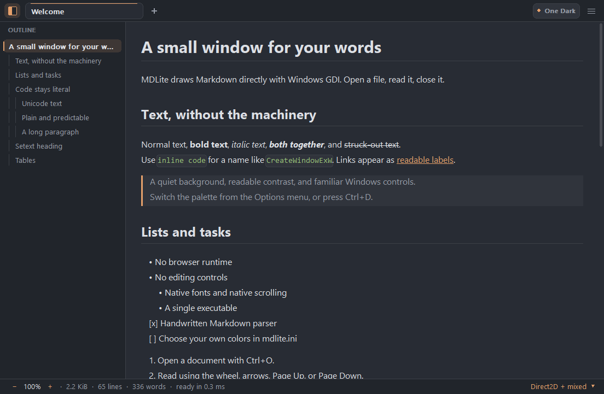

# MDLite

A blazing-fast, dependency-free native Win32 Markdown reader for Windows. Written
in pure Rust directly against Win32, GDI, GDI+, DirectWrite, and Direct2D: zero
external crates, no browser engine, no GUI framework, ~620 KiB single executable,
and ~10 MiB Private RAM on normal documents.



- **Blazingly fast & potato-friendly.** Boots in ~85–100 ms, reloads 10,000 unique
  Unicode + emoji lines in ~18 ms, relayouts a 2,000-row table in ~0.4 ms, uses
  ~10 MiB Private RAM on regular docs (~47 MiB even on 100,000 lines), and burns
  0 ms idle CPU.
- **Unified modern theme & typography.** 10 built-in palettes (One Dark, One
  Light, GitHub Dark/Light, Solarized Dark/Light, Gruvbox Dark, Nord, Dracula,
  Tokyo Night) plus High Contrast and custom palettes in `mdlite.ini`. Window
  frame, title bar, menu bar, floating rounded tabs, outline sidebar, floating
  zoom pill, scrollbar, footer, and Settings dialog all update live in the same
  theme, using Windows 11's `Segoe UI Variable` and `Cascadia Mono` (falling back
  to `Segoe UI` and `Consolas`).
- **Tabs & Heading Outline.** Open multiple documents in tabs (`Ctrl+T`,
  `Ctrl+W`, `Ctrl+Tab`, `Ctrl+1..9`, middle-click close, drag-and-drop) with O(1)
  cached switching, plus a collapsible, resizable heading outline sidebar
  (`Ctrl+B`) with live scroll-spy and click-to-jump.
- **Select & Copy (Plain Text or Markdown).** Drag to select or double-click a
  word. `Ctrl+C` (and right-click **Copy**) copies clean plain text with no
  Markdown syntax; right-click **Copy as Markdown** (`Ctrl+Shift+C`) preserves
  exact Markdown formatting.
- **Clickable Links.** Click web URLs (`http://`, `https://`, `mailto:`) to open
  in your default browser, `#section` links to jump in-document, and relative or
  absolute `.md` / `.markdown` / `.mdown` / `.mkd` links (with optional `#anchor`)
  to open directly in a new tab.
- **Three text pipelines, chosen per block.** GDI for Latin, GDI+ for Greek,
  Cyrillic, and CJK, Direct2D for Arabic, Hebrew, Indic, and Thai, with color
  emoji drawn cluster by cluster inside whichever pipeline drew the line.
- **Clean Windows Installer.** Inno Setup wizard installs per-user with no admin
  rights, optionally registers MDLite as the default `.md` reader, and uninstalls
  cleanly.

## Install

Download and run `MDLite-Setup-0.3.0.exe` from the Releases page (requires 64-bit
Windows 10 version 1703 or later).

- **For you only** is the default: no administrator rights, installed under
  `%LOCALAPPDATA%\Programs\MDLite`.
- **Make MDLite the default reader for Markdown files** is available in the
  installer and anytime under **Options > Settings** (`Ctrl+,`).
- Settings live in `%APPDATA%\MDLite\mdlite.ini` (or next to `mdlite.exe` in
  portable mode).

```powershell
# Silent install ("assoc" registers default reader)
MDLite-Setup-0.3.0.exe /VERYSILENT /CURRENTUSER /TASKS="assoc"
# Silent uninstall (/purge=1 also deletes saved settings)
& "$env:LOCALAPPDATA\Programs\MDLite\unins000.exe" /VERYSILENT /purge=1
```

## Run without installing

`mdlite.exe` is a single standalone executable with zero runtime dependencies:

```powershell
.\dist\mdlite.exe .\examples\showcase.md
```

| Action | Shortcut |
| --- | --- |
| Open, open in new tab, close tab | `Ctrl+O`, `Ctrl+T`, `Ctrl+W` |
| Switch tabs | `Ctrl+Tab`, `Ctrl+Shift+Tab`, `Ctrl+1..9` |
| Toggle heading outline | `Ctrl+B` |
| Copy plain text / Copy as Markdown | `Ctrl+C` / `Ctrl+Shift+C` (or right-click) |
| Select all / Clear selection | `Ctrl+A` / `Esc` |
| Reload document / Reload `mdlite.ini` | `F5` / `Ctrl+F5` |
| Next theme / Settings | `Ctrl+D` / `Ctrl+,` |
| Zoom in / out / reset | `Ctrl++` / `Ctrl+-` / `Ctrl+0` (or `Ctrl+Wheel`) |
| Scroll | Wheel, arrows, Page Up/Down, Space, Home/End |

## Build

Install stable Rust with the Windows MSVC toolchain, then:

```powershell
.\build.ps1 -Test
```

To build and verify the Windows installer (requires [Inno Setup 6.4+](https://jrsoftware.org/isinfo.php)):

```powershell
.\installer\build-installer.ps1 -Test   # dist\installer\MDLite-Setup-0.3.0.exe
.\installer\verify-installer.ps1        # installs, checks, uninstalls, diffs registry
```

## License

MIT. See [LICENSE](LICENSE).
